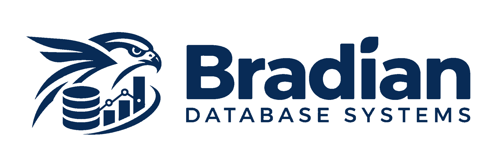

<p align="left">
  
</p>

# Bradian Database Systems

**A proprietary relational, analytical and hybrid database platform by Vitalworks Limited.**

Bradian Database Systems is being engineered as a native, general-purpose database management system that combines **OLTP**, **OLAP**, and **HTAP** with secure, built-in horizontal scaling, independent distributed installations and browser-based administration through **Bradian Studio**. The product is intended to operate on Linux, Windows, macOS and supported Unix-like systems, from a single-node installation to multi-node clusters and federated deployments.

> **Development status — pre-release.** This repository currently contains an operational analytical-engine foundation, a **WAL-backed persistent relational metadata catalog**, a portable physical page codec, a **single-process WAL-backed persistent row store**, and **typed, schema-bound table CRUD with primary-key uniqueness checks**, synchronized WAL batches, page checkpoints, a **disk-resident checkpoint B+tree** for indexed lookups and ranges, and a **bounded physical page cache** with generation-aware invalidation, and a **WAL-backed mutable index overlay** for post-checkpoint inserts, updates and deletes, **crash-safe reconstruction of missing derived B+tree indexes**, a **checksummed atomic checkpoint manifest**, and **consistent, verified backup and restore** of committed snapshot generations plus newer WAL records. It does **not yet** provide production-grade general SQL, multi-operation ACID/MVCC transactions, a disk B+tree, distributed SQL, automatic sharding, or an independently qualified security stack. Product targets below are requirements, not claims of implemented functionality.

## Product architecture

| Bradian subsystem | Responsibility | Present implementation |
|---|---|---|
| **Bradian Core** | Common types, runtime, catalogs, resource governance, portability | Foundational Rust libraries |
| **Bradian Transaction Engine (OLTP)** | Row storage, SQL writes, constraints, B+tree indexing, ACID/MVCC, WAL and recovery | Catalog, WAL-backed typed rows, and immutable on-disk B+tree, native SQL subset and single-table SQL sessions and explicitly registered cross-table shared-WAL SQL; no migration/MVCC |
| **Bradian Analytics Engine (OLAP)** | Proprietary columnar storage, vectorized execution, aggregation, optimized queries | Analytical engine foundation |
| **Bradian Hybrid Engine (HTAP)** | Commit-consistent row/column snapshots and combined query planning | Architecture target; not implemented |
| **Bradian Cluster Fabric** | Secure membership, consensus, native routing, sharding and rebalancing | Analytical federation primitives; not a distributed SQL cluster |
| **Bradian Federation** | Controlled synchronization and querying among autonomous installations | Domain-specific foundations |
| **Bradian Security** | Identities, SQL authorization, audit, encryption and cluster trust | Security primitives and **local-only bootstrap API gate** |
| **Bradian Connect** | JDBC/ODBC, data ingestion, migrations, adapters | Source adapters and DHIS2 analytics integration |
| **Bradian Studio** | Web-browser database administration, SQL, cluster operations and telemetry | React analytics administration foundation |

### Architectural principles

Bradian's transactional row representation and committed transaction log are intended to become the **authoritative source of truth**. Its columnar analytical representations will be consistent, versioned projections—not an independent source of transactional truth. Nodes in one strong cluster will have explicit quorum and transaction rules; autonomous installations will use independently defined federation and conflict-resolution semantics. Bradian must not depend on another third-party database server as its primary database engine.

Security, recovery, correctness and operational transparency take precedence over unchecked performance claims. The platform will use well-reviewed cryptographic libraries rather than custom cryptographic algorithms.

## Engineering documentation

The primary specification is **[Bradian Master Architecture and SRS v1.1](docs/Bradian_Master_Architecture_SRS_v1.1.md)**. Start with the [Bradian documentation index](docs/README.md), which links to security requirements, the architecture decision records, implementation gates and historical source material.

| Reference | Purpose |
|---|---|
| [Master Architecture & SRS v1.1](docs/Bradian_Master_Architecture_SRS_v1.1.md) | Product requirements, subsystems, security and implementation programme |
| [Engineering audit and roadmap](docs/implementation/BRADIAN_V1_1_AUDIT.md) | Code-to-SRS gaps and prioritized engineering stages |
| [Relational catalog ADR](docs/adr/0006-generic-relational-catalog.md) | Generic catalog boundary and identifiers |
| [Physical page ADR](docs/adr/0007-portable-physical-page.md) | First native page-envelope specification |
| [Relational catalog gate](docs/gates/BRD-G1-relational-catalog.md) | First relational engineering milestone |
| [Physical page gate](docs/gates/BRD-G2-page-format.md) | Portable page format and outstanding durability requirements |
| [Atomic WAL row-store gate](docs/gates/BRD-G3-wal-row-store.md) | Local WAL-backed row operations and checkpoint recovery |
| [Typed table gate](docs/gates/BRD-G4-typed-table-crud.md) | Persisted typed table CRUD, schema pinning and primary-key checks |
| [Disk B+tree index gate](docs/gates/BRD-G5-checkpoint-btree.md) | Immutable on-disk B+tree, point lookup, range scans and WAL-aware routing |
| [Buffer pool gate](docs/gates/BRD-G6-buffer-pool.md) | Bounded verified physical page cache, LRU eviction and checkpoint generation isolation |
| [Mutable index overlay gate](docs/gates/BRD-G7-mutable-index-delta.md) | WAL-backed live inserts, updates and deletes merged with on-disk checkpoint B+tree |
| [Derived index recovery gate](docs/gates/BRD-G8-index-recovery.md) | Recover missing indexes after interrupted publication; verify physical pointers against authoritative pages |
| [Atomic checkpoint publication gate](docs/gates/BRD-G9-checkpoint-publication.md) | Manifest-committed generation selection, orphan quarantine and WAL-safe publication |
| [Consistent backup/restore gate](docs/gates/BRD-G10-consistent-backup-restore.md) | Captures one synchronized checkpoint+WAL state and restores into a verified new database directory |
| [Persistent relational catalog gate](docs/gates/BRD-G11-persistent-catalog.md) | Stable database/schema/table identities, replay-validated DDL, and metadata-only backup |
| [Native SQL execution gate](docs/gates/BRD-G12-native-sql.md) | Bounded CREATE, INSERT, SELECT, UPDATE and DELETE using persistent catalog and typed tables |
| [Single-table transactions gate](docs/gates/BRD-G13-single-table-transactions.md) | Snapshot-based staging, rollback, optimistic conflicts, one durable WAL batch per commit |
| [Scoped SQL transaction sessions](docs/gates/BRD-G14-scoped-sql-transactions.md) | SQL BEGIN/COMMIT/ROLLBACK and DML within one Rust-callback table session |
| [Shared-WAL multi-table transactions](docs/gates/BRD-G15-shared-wal-multi-table.md) | Atomic cross-table row changes in a separately registered transaction domain with one durable WAL batch |
| [Shared-domain SQL transactions](docs/gates/BRD-G16-shared-domain-sql.md) | SQL BEGIN/COMMIT across explicitly registered shared-WAL tables, with legacy table storage refused |
| [Verified legacy SQL migration](docs/gates/BRD-G17-verified-legacy-migration.md) | Offline locked copy of legacy tables into a separately verified shared-WAL destination; original rows retained |
| [Catalog/domain lifecycle recovery](docs/gates/BRD-G18-catalog-domain-lifecycle.md) | WAL-backed Pending/Active provisioning, automatic restart reconciliation and schema-pin integrity checks |
| [Database-wide backup and restore](docs/gates/BRD-G19-database-wide-backup.md) | Coordinated catalog/domain/lifecycle checkpoint+WAL archives, checksummed manifest and verified new-root restore |
| [MVCC row-version foundation](docs/gates/BRD-G20-mvcc-foundation.md) | Opt-in in-memory pinned row versions, per-key optimistic writes and WAL-durable latest state |
| [Typed MVCC SQL integration](docs/gates/BRD-G21-typed-sql-mvcc.md) | Opt-in concurrent SQL snapshots over validated G15 table pins and G20 per-key conflict detection |
| [Durable MVCC historical versions](docs/gates/BRD-G22-durable-mvcc-history.md) | Opt-in WAL-atomic version-key history, restart-safe as-of reads, explicit durable retention and GC |
| [Durable typed SQL history](docs/gates/BRD-G23-durable-typed-sql-history.md) | SQL SELECT AS OF retained WAL positions, typed G22 rows and verified offline G16 shared-domain cutover |
| [Historical backup and restore](docs/gates/BRD-G24-history-backup-restore.md) | Separate, checksum-verified G23 catalog and history-domain archives with staged restore |
| [Lifecycle-to-history cutover](docs/gates/BRD-G25-lifecycle-history-migration.md) | Verified G18 snapshot and separately published G23 history root, preserving the original database |
| [Historical schema inspection](docs/gates/BRD-G26-historical-schema-inspection.md) | Validated immutable G22 schema registration epochs and SQL DESCRIBE TABLE AS OF |
| [Additive schema compatibility](docs/gates/BRD-G27-additive-schema-compatibility.md) | Read-only nullable-column compatibility planning and historical row projection |
| [Durable prepared schema intents](docs/gates/BRD-G28-durable-schema-intents.md) | WAL-backed compatible schema proposal preparation and fail-closed restart validation; no ALTER activation |
| [Durable schema intent cancellation](docs/gates/BRD-G29-durable-schema-cancellation.md) | WAL-atomic aborted decisions, validated after restart and backup restore; ALTER remains disabled |
| [DDL coordination fences](docs/gates/BRD-G30-ddl-coordination-fences.md) | Durable G11 catalog LSN binding for inactive historical schema proposals; no ALTER activation |
| [DDL readiness certificates](docs/gates/BRD-G31-ddl-readiness-certificates.md) | Durable inactive schema readiness decisions with replay and G24 restore verification |
| [Epoch-bound row codec](docs/gates/BRD-G32-schema-epoch-row-codec.md) | Opt-in BRVE typed row envelope, strict schema epoch decoding and legacy format preservation |
| [Inactive catalog schema revisions](docs/gates/BRD-G33-inactive-catalog-schema-revisions.md) | G11 WAL-replayed proposed table definitions with inactive schema isolation and safe compatibility checks |
| [Bootstrap API security](docs/security/BOOTSTRAP_API_AUTH.md) | Temporary local development restrictions |

## Repository organization

```text
bradian-db/
├── crates/
│   ├── bradian-relational/       # Persistent catalog, native SQL, WAL rows, typed tables, disk B+tree
│   ├── dap-core/                 # Legacy core primitives
│   ├── dap-storage/              # Existing .derc analytical segments, WAL and snapshots
│   ├── dap-runtime/              # Analytical execution operators
│   ├── dap-planner/              # Existing analytics query planning
│   ├── dap-security/             # Security primitives
│   ├── dap-serving/              # Existing analytical HTTP API
│   └── ...                      # Other analytical and DHIS2 integration crates
├── apps/
│   ├── dap-ui/                   # Bradian Studio React application (legacy directory)
│   └── dhis2-integration/        # Optional DHIS2 analytics integration
├── docs/                        # Master SRS, ADRs, gates and security documentation
└── tests/                       # End-to-end integration tests
```

Legacy internal directory and crate names are retained temporarily to protect API, build and storage compatibility. **The product and repository are named Bradian Database Systems / `bradian-db`, not DAP.** Renaming persisted formats or Rust crates requires a documented compatibility migration.

## Local development

### Requirements

- Rust toolchain specified in [rust-toolchain.toml](rust-toolchain.toml)
- Node.js and npm for Bradian Studio
- Compatible development operating system with a writable data directory

### Rust workspace

```sh
cargo check --workspace --locked
cargo test --workspace --locked
```

To test the current relational catalog and physical page codec:

```sh
cargo test -p bradian-relational --locked
```

### Bradian Studio

```sh
cd apps/dap-ui
npm install
npm run dev
```

The browser interface is at the Vite development-server address, normally `http://localhost:5173`. The existing API expects a local Rust process on port 8080. **Protected analytical endpoints require authentication that the current Studio does not yet implement as a browser session.** The UI is not a production-ready secured database management console.

### Local-only analytical API

For development, inject a cryptographically strong administrator token through your secret-management mechanism as `BRADIAN_API_TOKEN` (at least 32 non-whitespace characters), then launch the CLI:

```sh
cargo run -p dap-admin -- serve --root ./data --bind 127.0.0.1:8080
```

Requests to protected endpoints must include `Authorization: Bearer <token>`. The bootstrap API refuses non-loopback binds; it does not provide production TLS, individual login sessions, RBAC, token expiry or data-level authorization. Refer to the [security limitations](docs/security/BOOTSTRAP_API_AUTH.md).

## Branding

The approved Bradian horizontal logo is available in [navy blue](docs/media/Bradian_Database_Systems_Primary_Horizontal_Blue.svg) and [white](docs/media/Bradian_Database_Systems_Primary_Horizontal_White.svg). Bradian Studio uses the approved white mark on its dark navigation and a cropped version of the approved blue artwork for the browser icon. Logo geometry must not be redrawn or restyled.

## Delivery principles

Every milestone must produce tested, executable functionality and traceable requirements. SQL correctness, transaction isolation, crash recovery, secure authorization, cluster safety, and backup restoration are separate release gates. Experimental or in-memory components must never be represented as production-complete.

**Maintainer:** Vitalworks Limited · **Repository:** [socaya/bradian-db](https://github.com/socaya/bradian-db)
