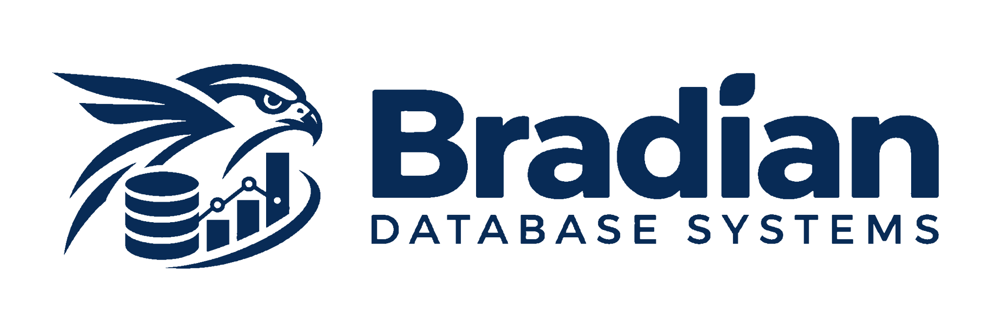

<p align="left">
  
</p>

# Bradian Studio

**Browser-based administration and analytics workspace for Bradian Database Systems**

Bradian Studio is the web administration application for the Bradian database product. The existing frontend provides analytical engine monitoring and management, while the full enterprise database console described in the [Bradian Master Architecture & SRS v1.1](../../docs/Bradian_Master_Architecture_SRS_v1.1.md) is under active development.

**Current status:** pre-release analytical administration foundation. Database creation, native SQL DDL/DML, full user management, MVCC diagnostics and production cluster operations are **not** currently implemented.

## Branding and interface

- Use the approved white horizontal Bradian logo at `public/bradian-logo.svg` on dark navigation and the approved blue version at `public/bradian-logo-blue.svg` on light surfaces.
- The browser favicon uses a crop of the approved blue artwork; the logo itself must not be redrawn.
- Retain the calm enterprise design system: restrained navy/teal accents, visible typography, clear page structure, predictable spacing, no gradients or decorative status chips.
- Display **Bradian Studio** as the application name, and **Bradian Database Systems** as the database product. Treat DHIS2 as an optional integration rather than the identity of the application.

## Application structure

The codebase currently resides in `apps/dap-ui/`, a legacy directory name preserved until the broader crate and integration migration is planned. The npm package is named `bradian-studio`.

The frontend uses React, TypeScript, React Router, TanStack Query and Vite, with local CSS design tokens under `src/design/`. The API client is maintained in `src/api/client.ts` and connects to the analytical HTTP endpoints currently implemented in the Rust server.

### Existing screens

| Route | Current purpose |
|---|---|
| `/` | Operational overview and engine health |
| `/sources` | Data-source inspection |
| `/storage` | Existing analytical storage catalog |
| `/workbench` | Analytics query workbench |
| `/history` | Query history |
| `/views` | Materialized views |
| `/products` | Data products |
| `/nodes` | Distributed analytics node views |
| `/reconciliation` | Reconciliation diagnostics |
| `/dhis2-parity` | Optional DHIS2 compatibility view |
| `/security` | Security and audit UI foundation |
| `/backups` | Backup and recovery view |
| `/benchmarks` | Benchmark metrics |
| `/settings` | UI settings prototype |

These screens are not proof that every associated back-end operation is implemented.

## Run locally

```sh
cd apps/dap-ui
npm install
npm run dev
```

Vite normally serves at `http://localhost:5173`; `/api` is proxied to the local Rust process at `127.0.0.1:8080`. To build a static bundle, run `npm run build`.

**Authentication limitation:** the Bradian analytical API now requires a local-development administrator bearer token, but Studio does not yet implement a secure login/session exchange. No static token may be embedded in browser assets, JavaScript bundles, query strings or local storage to bypass that requirement. Full Studio login, session handling, CSRF protection and scoped authorization are future security milestones.

## Engineering guidance

Follow the [Bradian documentation index](../../docs/README.md), [v1.1 SRS](../../docs/Bradian_Master_Architecture_SRS_v1.1.md) and the [implementation roadmap](../../docs/implementation/BRADIAN_V1_1_AUDIT.md). Avoid labeling planned screens as complete. Do not change existing analytical API paths or storage identifiers without compatibility testing.
